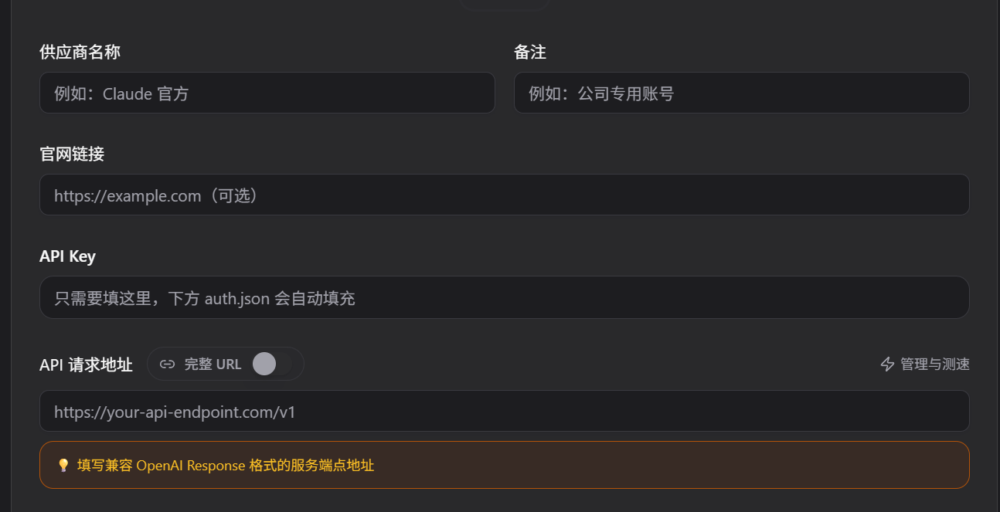
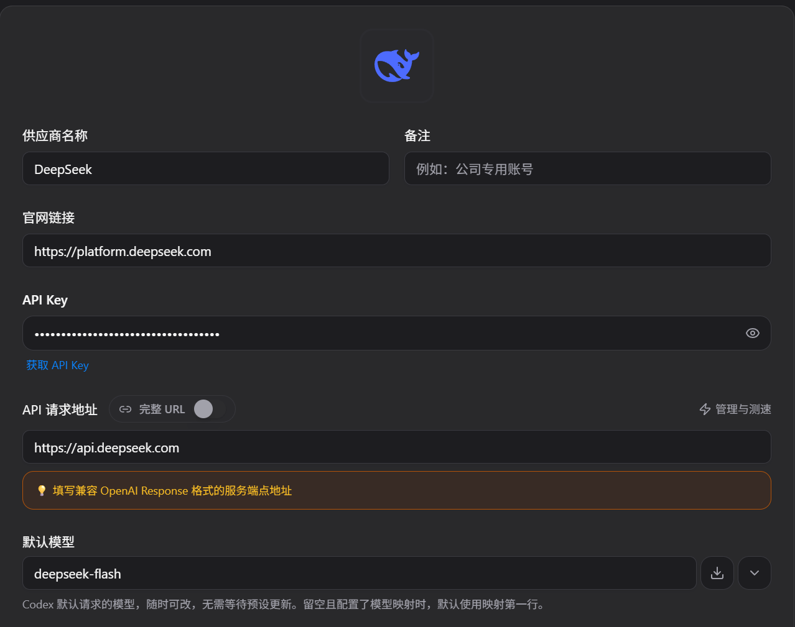

# 如何光速开启Codex之旅

## 相关资源链接
- [OpenCodeX](https://github.com/lidge-jun/opencodex/blob/main/readme/README.zh-CN.md)
- [CC-Switch](https://github.com/farion1231/cc-switch)
- [OpenAI](https://openai.com/zh-Hans-CN/)

## 如何开始

- **安装ChatGPT**

点击[OpenAI](https://openai.com/zh-Hans-CN/)，在此处下载ChatGPT的官方客户端，安装完成后，选择API模式登录，如果你有ChatGPT的API密钥，输入并往该API中氪金即可。

如果你没有合适的境外支付的方式以供给你的API工作，则你需要往下看。

- **安装CC-Switch**

点击[CC-Switch](https://github.com/farion1231/cc-switch)，按照其中的README.md进行安装，安装过程省略。

- **寻找一个合适的中转站**

这一步需要大家呼朋唤友寻求中转站的帮助，如果有需要的可以联系我私聊提供中转站:D，这里不公开提供。

- **配置CC-Switch**

CC-Swtich安装完毕后，在你选择的中转站界面中新建一份API，复制并记录该API密钥。（部分中转站具有一键添加CC-Switch选项，可直接使用）

在CC-Switch界面中选择Codex。

此后选择右上角的加号，此后在“API key”部分输入你复制的API密钥，在“API请求地址”处输入你选择的中转站相对应的地址，其余部分按需求填写即可。

配置完毕后，切换新建的站点，重启CC-Switch，并保证CC-Switch先打开，ChatGPT后打开，即可使用你的API站点进行使用了。

- **如何让你的codex里藏有一只大肥鱼**

按照图片配置并重启使用即可，关于大肥鱼的各种版本，建议查询Deepseek官方文档进行填写。

